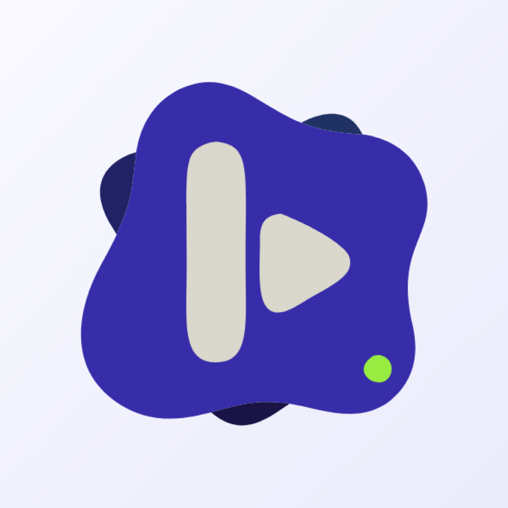

<p align="center">
  
</p>

<h1 align="center">Koda for iPhone</h1>

<p align="center">
  <b>A YouTube Music player for iOS, written in SwiftUI with Liquid Glass.</b>
</p>

<p align="center">
  <a href="https://github.com/Ivorisnoob/Koda-iOS/releases/latest"></a>
  
  
  <a href="https://t.me/ivorisnoob_chat"></a>
</p>

Koda plays music from YouTube Music without an account and without ads. Your library, history and stats stay on your iPhone. It is the iOS sibling of [Koda for Android](https://github.com/Ivorisnoob/Koda): music only, and built for iOS rather than ported to it.

## Download

Get `Koda.ipa` from **[the latest release](https://github.com/Ivorisnoob/Koda-iOS/releases/latest)**. Koda needs iOS 26 or later.

## Installing

Koda isn't on the App Store, so you sign it yourself with your Apple ID, using any of these:

| Tool | How |
|---|---|
| [AltStore](https://altstore.io) | With AltServer running on your computer, open AltStore on the iPhone, go to **My Apps**, tap **+** and pick `Koda.ipa`. |
| [SideStore](https://sidestore.io) | The same, without needing a computer after setup. |
| [Sideloadly](https://sideloadly.io) | Connect the iPhone to your computer, drop `Koda.ipa` in, sign in and start. |

A free Apple ID's signature lasts seven days; AltStore and SideStore renew it for you. The first time, iOS may ask you to trust your Apple ID in **Settings → General → VPN & Device Management**.

## Features

### Listening

- **Your Mix** on Home, woven from radios of the artists you play most, with recent listening counting more
- **Jump back in**, **Quick picks**, your top artists, new releases and YouTube Music's own shelves
- Gapless playback that keeps going in the background, with lock screen, Control Center and AirPlay
- Shuffle, repeat, autoplay radio and a queue you can drag to reorder
- Swipe the mini player left or right to skip; a sleep timer for a set time or the end of the song
- Volume normalization, so loud masters play at a similar level to everything else

### Lyrics

- Word by word from YouLyPlus and BetterLyrics, line by line from LRCLIB, chosen automatically
- Duets on their singer's side, backing vocals under their line, long notes that swell
- Tap a line to jump to it; long-press to share up to six lines as a card in the song's colours
- Pick and reorder the sources, the text size and the motion in Settings

### Finding music

- Search with suggestions and filters for songs, albums, artists and playlists
- Search by voice, recognized on the device where the iPhone supports it
- Paste a YouTube or YouTube Music link into Search to open it; `koda://` links work from Shortcuts
- Moods and genres to browse

### Your library

- Liked songs, saved albums, playlists and artists, and playlists of your own
- A profile with listening stats: time listened each day, streaks, top songs and artists
- Back up the whole library to one file and restore it on another iPhone
- Pause listening or search history whenever you like

## Privacy

Koda has no account, no analytics and no server of its own. What you like, save, play and search is stored on your iPhone and leaves it only when you back it up. Requests go to YouTube Music for music and to the lyrics services for lyrics.

## Building

Xcode 26 or later.

```sh
cd KodaCore && swift test                          # unit tests
KODA_LIVE=1 swift test --filter Live               # against live YouTube, plays muted audio
xcodebuild -project Koda.xcodeproj -scheme Koda -destination 'generic/platform=iOS' build
```

Every push runs the tests and builds an unsigned `Koda.ipa` on GitHub Actions; it is in the run's artifacts.

| Path | What |
|---|---|
| `KodaCore/` | Swift package with no UI: the InnerTube client, parsers, stream resolution, lyrics, the library, the queue and the player |
| `Koda/` | The SwiftUI app |
| `.github/workflows/build.yml` | Tests and the unsigned `.ipa` build |

## Feedback

Found a bug or want something? Open an [issue](https://github.com/Ivorisnoob/Koda-iOS/issues) or say it in the [Telegram community](https://t.me/ivorisnoob_chat).

## Thanks

Lyrics come from [LRCLIB](https://lrclib.net), YouLyPlus and BetterLyrics.

---

Koda is an unofficial client and is not affiliated with YouTube or Google.
